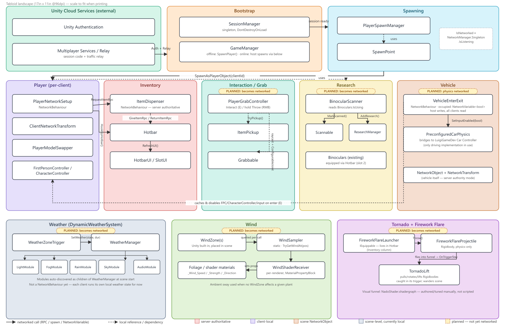

# System Architecture

How the game's major systems are structured and how they communicate, both locally and over the network (Unity Netcode for GameObjects, transported via Unity Multiplayer Services / Relay).

---

## 1. High-level diagram

Landscape, sized for tabloid paper (`System-Architecture.svg`, 17"×11" at 96dpi) — open the `.svg` directly
and scale-to-fit when printing for the sharpest result; the `.png` is a same-layout raster fallback for
tools that don't render inline SVG. This revision folds in everything added since the first version
(vehicle, weather, wind, tornado/firework, grab/interaction) alongside the original multiplayer core, so
it no longer fits a single US-letter page at full size — it's meant to be read on screen or printed large.

**Notes on the diagram:**

- **Top row = one-time bootstrap.** A client authenticates and gets a Relay session (Unity Cloud
  Services), the local `SessionManager` reports "session ready," and the server-side
  `PlayerSpawnManager` picks a spawn point. This runs once per player joining, not every frame.
- **Middle row = per-client gameplay**, once that player object exists: `Player`, `Inventory`,
  `Interaction/Grab`, `Research`, and `Vehicle` are the systems doing actual gameplay logic while a
  player is in the world.
- **Bottom row = scene-level/environment systems**: `Weather`, `Wind`, and `Tornado + Firework Flare`.
  These aren't spawned per-player — they live in the scene and currently aren't networked; each client
  simulates its own local copy. That's a temporary state, not the design goal: this is a multiplayer-first
  game, so these (plus `Interaction/Grab` and `Vehicle` driving physics) are expected to get networked
  over time, following the dispenser's server-authoritative pattern. The amber dashed badges on the
  diagram mark exactly which boxes that applies to.
- **Color = ownership, not just grouping.** Purple (Player) and yellow (Research) are client-local —
  each client only sees its own copy. Pink (Inventory) and rust (Vehicle) contain the
  server-authoritative/NetworkObject pieces; everything else in those boxes is local logic or UI
  reacting to them. Slate/green/lavender (Weather/Wind/Tornado) are scene-level and non-networked.
- **Solid arrows are real network traffic** (an RPC, a `NetworkObject` spawn call, or a
  `NetworkVariable`); **dashed arrows are plain C# references** resolved locally, no network involved.
  That distinction is why `ItemDispenser`'s two solid arrows to `Hotbar` and `VehicleEnterExit`'s
  `occupied` NetworkVariable are the only genuinely networked gameplay state outside of the bootstrap
  spine and player-object spawning itself.

## 2. Systems and where authority lives

| System | Key scripts | Runs on | Notes |
|---|---|---|---|
| **Unity Cloud Services** | *(external, not our code)* | Cloud | Unity Authentication issues the anonymous identity; Multiplayer Services/Relay brokers the session code and relays traffic between host and clients so no one needs a public IP/port-forwarding. Everything downstream depends on these two calls succeeding first. |
| **Session bootstrap** | `SessionManager`, `GameManager` | Every client (host + joiners) | `SessionManager` wraps Unity Authentication + Multiplayer Services (singleton, `DontDestroyOnLoad`). `GameManager` branches on `PlayerSpawnManager.IsNetworked` — offline it spawns a local player itself; online it leaves spawning to the host via `PlayerSpawnManager`. |
| **Spawning** | `PlayerSpawnManager`, `SpawnPoint` | Server/host only calls `SpawnNetworkedPlayer` | Picks a spawn-point group once per session, then hands out points by strategy (Random/RoundRobin/First). Calls `NetworkObject.SpawnAsPlayerObject(clientId)` — this is what makes the player object server-owned-but-client-controlled. |
| **Player** | `PlayerNetworkSetup`, `ClientNetworkTransform`, `PlayerModelSwapper`, `FirstPersonController`/`CharacterController` | Split: logic runs everywhere, effects gated by `IsOwner` | On `OnNetworkSpawn`, non-owned instances get their camera/input disabled so remote players don't fight the owner's Cinemachine brain. The owner's own camera is enabled a frame later, after everyone else's is confirmed off. `FirstPersonController`/`CharacterController` are what `VehicleEnterExit` disables while a player is driving. |
| **Inventory (UI/state)** | `Hotbar`, `HotbarUI`, `SlotUI`, `IEquippable` | Client-local | Not a `NetworkBehaviour`. Each client's hotbar only reflects that client's items. `HotbarUI` lives on a scene `Canvas`, so `PlayerNetworkSetup`/`PlayerSpawnManager` reach in and wire `hotbar.hotbarUI` post-spawn, then call `RefreshUI()`. |
| **Item dispenser** | `ItemDispenser` | `NetworkBehaviour`, server-authoritative | One of the two genuinely networked gameplay exchanges. Server owns the pool (`_remaining`); a `NetworkVariable<int>` mirrors the remaining count to all clients for UI ("Press E" vs "Empty") without them needing to ask. |
| **Interaction / Grab** | `PlayerGrabController`, `ItemPickup`, `Grabbable` | Client-local, not yet networked (planned) | Interact (E) either calls `ItemPickup.TryPickup` (walk-into-it hotbar pickup) or, for anything with a `Grabbable`, raycasts and hangs the object off a `ConfigurableJoint` for REPO-style physical carrying — drop on Interact again, hold Throw (RMB) to charge and release. Other players can't currently see a grab/carry in progress; that's planned to be networked so carried objects are visible to everyone. |
| **Research** | `BinocularScanner`, `Scannable`, `ResearchManager`, `Binoculars` | Client-local, not yet networked (planned) | Self-contained scan-and-fill loop; no RPCs today. `BinocularScanner` reads `Binoculars.IsUsing`, raycasts for a `Scannable`, fills a bar over `scanDuration`, then calls `MarkScanned()` and `ResearchManager.AddResearch()`. Scan progress/completion is planned to be shared across players later, same request/reply shape as the dispenser — see `Assets/docs/CloudResearch-Explainer.md` for the full build log. |
| **Vehicle** | `VehicleEnterExit`, `PreconfiguredCarPhysics` (→ LuigiGameDev Car Controller), `NetworkObject`/`NetworkTransform` | Mixed; driving physics not yet networked (planned) | `VehicleEnterExit` is a `NetworkBehaviour` with an `occupied` `NetworkVariable<bool>` (host writes, everyone reads), and calls `SetInputEnabled` on `PreconfiguredCarPhysics`, a plain, non-networked `MonoBehaviour` that bridges this project's enter/exit conventions to the LuigiGameDev Car Controller asset — the only driving implementation currently in use (earlier `TruckWheelDrive`/`TruckNewTEST` experiments are no longer wired up). The vehicle's own `NetworkObject`/`NetworkTransform` replicates its transform, but physics is simulated locally on every machine with no ownership handoff on enter. Giving the driver authority over the vehicle's physics is planned — see `Assets/docs/TruckRoot-Explainer.md` for the full multiplayer-authority caveat and the suspension/steering tuning history. |
| **Weather** | `WeatherManager`, `WeatherZoneTrigger`, and `LightModule`/`FogModule`/`RainModule`/`SkyModule`/`AudioModule` (DynamicWeatherSystem) | Client-local, not yet networked (planned) | `WeatherZoneTrigger` calls `WeatherManager.SetWeather(state, duration)` when a player's `CharacterController` enters its trigger. Modules are auto-discovered as children of `WeatherManager` at scene start and each own one slice of the transition (lighting, fog, rain, sky, audio). Each client runs its own local weather state for now; syncing it is planned so every player sees the same weather. |
| **Wind** | `WindSampler` (static), `WindShaderReceiver`, Unity `WindZone` | Client-local, scene-level, not yet networked (planned) | `WindSampler.TryGetWindAt(pos)` scans scene `WindZone`s on demand (directional or spherical falloff). `WindShaderReceiver` sits per-renderer, queries the sampler every frame, and pushes `_Wind_Speed`/`_Wind_Strength`/`_Wind_Direction` into a `MaterialPropertyBlock` — falling back to its own ambient sway values when no `WindZone` is in range. Also drives the `WindShaderReceiver`/anemometer-adjacent gameplay planned but not yet built; the anemometer item itself is planned to be networked gameplay, not just a local reading. |
| **Tornado + Firework Flare** | `TornadoLift`, `FireworkFlareLauncher`, `FireworkFlareProjectile` | Client-local, physics-driven, not yet networked (planned) | `FireworkFlareLauncher` is an `IEquippable` that lives in the Hotbar; throwing it spawns a `FireworkFlareProjectile` (pure `Rigidbody`, no tornado-side code needed). `TornadoLift` already pulls/rotates/lifts anything with a `Rigidbody` that enters its trigger via `OnTriggerStay`, wandering the scene between random points. The visual funnel itself is `NadoShader.shadergraph` — hand-tuned in the Shader Graph editor, not authored as JSON (see memory note on shader workflow). Tornado position/lift and flare throws are planned to be networked so every player sees the same tornado doing the same thing. |

## 3. Key request/response flow: taking an item from a dispenser

This is one of only two genuinely networked gameplay exchanges in the project (the other being the
`occupied` flag on a vehicle), so it's worth tracing in full:

1. Client walks into the dispenser's trigger collider → `OnTriggerEnter` grabs that player's `Hotbar` (only for objects the client owns — remote players' triggers are ignored via `NetworkObject.IsOwner`).
2. Client presses **E** → if a hotbar slot is free and the synced `_remainingCount` is > 0, sends `RequestItemRpc` (`SendTo.Server`).
3. **Server** picks a random remaining index, removes it from `_remaining`, updates `_remainingCount` (auto-replicates to all clients), and replies with `GiveItemRpc` targeted at just the requesting client (`RpcTarget.Single`).
4. **Requesting client** receives the item index and calls `Hotbar.AddItem`. If the hotbar filled up while the request was in flight, it calls `ReturnItemRpc` back to the server to put the item back in the pool instead of dropping it.

This request/reply-with-rollback pattern is the template to reuse for any future networked pickup/interaction — keep the server as the single source of truth for anything shared (the pool), and let `NetworkVariable`s carry only the read-only bits every client needs for UI.

## 4. Not-yet-networked systems (planned)

This is a multiplayer-first game, so "client-local" below means "not networked yet," not "never will be."
`Research/*`, `Interaction/Grab` (`PlayerGrabController`/`ItemPickup`/`Grabbable`), `Weather`, `Wind`, and
the `Tornado`/`FireworkFlare` pair are all purely client-local today, with networking for each planned as
future work. The `Vehicle` system sits in between: its enter/exit state (`occupied`) is already networked,
but the actual driving physics is not yet (see `Assets/docs/TruckRoot-Explainer.md` §7 for why that's a
problem for non-host drivers specifically). The hotbar UI rendering itself is the one piece that's
expected to stay client-local permanently — each player only needs to see their own hotbar.

When multiplayer research, weather, interaction/grab, or vehicle-driving-physics get networked, they're
expected to follow the same shape as the dispenser: server holds the authoritative value, a
`NetworkVariable` mirrors it out for display, RPCs handle the action requests. The diagram marks every
box this applies to with an amber "PLANNED: becomes networked" badge.
